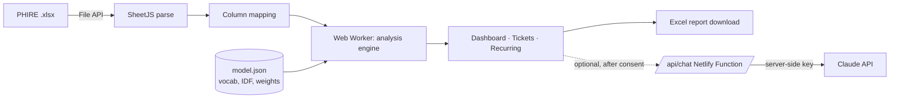

# Architecture

**Owner:** Software Architect (Hiro). Design goal: the fewest moving parts that meet the requirements, with ticket
data staying in the browser.

> Note: written after version 1 was built, to record the design the code follows.

## Stack and why

| Layer | Choice | Why |
|---|---|---|
| UI | React 18 + Vite 6 | Small, well-known, fast static build; deploys to Netlify with no server |
| Excel | SheetJS 0.20.3 (vendor CDN build) | Reads and writes .xlsx entirely in the browser |
| NLP training | Python, scikit-learn | Standard, explainable TF-IDF + Naive Bayes / logistic regression; grouped cross-validation |
| NLP inference | Hand-written JavaScript engine (`app/src/engine/`) | Runs the exported model in the browser; a parity test proves it matches scikit-learn |
| Background work | Web Worker | Similarity and clustering on hundreds of tickets without freezing the page |
| Language analysis (build time) | Python **NLTK 3.9.1** + **spaCy 3.8.18** (`en_core_web_sm`) in `pipeline/build_nlp.py`, run by the Netlify build | Netlify runs Python only at build time; results saved as static JSON |
| Language analysis (live) | **Pyodide 0.29.5**, self-hosted, running NLTK in a Web Worker | NLTK works in the browser; spaCy does not (not in Pyodide) |
| Optional chat | One Netlify Function (`/api/chat`) + Anthropic TypeScript SDK, Claude Sonnet | Keeps the API key server-side; off until a key is set |
| Hosting | Netlify (static site + function) | Free tier, deploys from GitHub on every push, headers via `netlify.toml` |
| Tests | Vitest (unit, parity, function), Playwright (browser) | Fast, no extra services; browser suite runs under the production CSP |

## Data flow

Build time (Netlify): `pipeline/build_nlp.py` runs NLTK and spaCy over the demo tickets → `app/public/nlp/language.json`,
and copies `nltk_core.py` + NLTK data for Pyodide. See [nltk-spacy-netlify.md](nltk-spacy-netlify.md).

Everything left of the dotted line runs in the user's browser. The only network requests are to the site itself:
the page, `model.json`, the demo export and, if the user starts a chat, `/api/chat`.

## Components

| Path | Responsibility | Owner |
|---|---|---|
| `nlp/train.py` | Train, select (template-grouped CV), evaluate once on test, export `model.json` and the parity fixture | NLP Specialist |
| `app/src/engine/text.js` | Preprocessing identical to `train.py`; TF-IDF vectors | Back-End Developer |
| `app/src/engine/classify.js` | Linear scoring for both models: softmax(x·W + b) | Back-End Developer |
| `app/src/engine/similarity.js` | Cosine similarity, references, average-linkage clustering | Back-End Developer |
| `app/src/engine/analyze.js` | Pipeline: classify, keywords, priority, neighbours, recurring issues | Back-End Developer |
| `app/src/lib/columns.js`, `excel.js` | Column mapping, dates, Excel in/out | Data Engineer |
| `app/src/lib/stats.js`, `search.js` | Dashboard aggregations, portfolio filter, search | Front-End Developer |
| `app/src/components/` | Pages and the ticket drawer, including the chat tab | Front-End Developer |
| `app/netlify/functions/chat.mjs` | Chat function: validation, password, prompt building, streaming | Back-End Developer, Security Reviewer |
| `app/scripts/build-experts.mjs` | Bundles agent instructions and knowledge folders for the function at build time | Data Engineer |
| `pipeline/build_nlp.py`, `nltk_core.py`, `patterns.py` | Build-time NLTK + spaCy analysis, EntityRuler patterns, evaluation report | NLTK Expert, spaCy Expert |
| `app/scripts/copy-pyodide.mjs`, `app/src/nltkWorker.js` | Self-hosted Pyodide (checksum-verified) and the live NLTK worker | Pyodide Engineer |
| `app/src/components/Language.jsx` | Language page: labelled NLTK / spaCy panels and the live NLTK box | Front-End Developer |
| `netlify.toml` | Build (Python pipeline then Node), function directory, CSP and security headers | Netlify Engineer, Security Reviewer |

## Key decisions

1. **Classical NLP in the browser instead of an LLM per ticket.** It's free, instant, explainable (deciding words) and
   private. The LLM is used only for the optional, per-ticket expert chat.
2. **One model file, two classifiers.** Both labels share one TF-IDF vocabulary; each label uses the model that won
   grouped cross-validation (module: logistic regression, issue area: Naive Bayes). Both score as softmax(x·W + b).
3. **Parity test as the contract** between the Python training code and the JavaScript engine.
4. **Strict CSP.** `connect-src 'self'` turns the "nothing leaves the browser" rule into something the browser enforces.
5. **Generated expert bundle outside `netlify/functions/`.** Netlify treats every file there as a function.
6. **NLTK and spaCy at build time, NLTK also live.** Netlify can't run Python per request and spaCy can't run in the
   browser, so both libraries run in the build; one shared `nltk_core.py` makes the browser's NLTK results identical.
