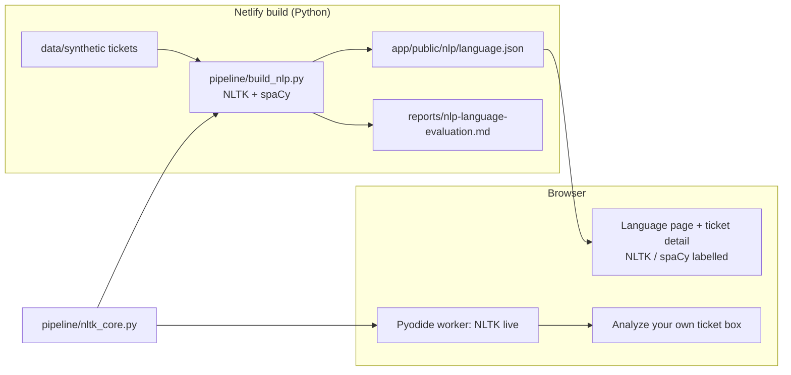

# 19. NLTK, spaCy and what Netlify can run

Research for the NLP Final Exam requirements: use **NLTK** and **spaCy** in one app deployed on **Netlify**, with no
outside servers. Use case: **support ticket triage** (one of the guide's suggested use cases: "NLTK: sentiment and
urgency keywords. spaCy: products and order numbers with an EntityRuler"), applied to PeopleSoft PHIRE tickets.

## What each library does best (for this use case)

| Library | Best at | Used here for | Official docs |
|---|---|---|---|
| **NLTK** 3.9.1 | Classic text processing: tokenizers, stopword corpora, **VADER** sentiment, **FreqDist**, **collocations** | Ticket sentiment (VADER), urgency keywords, top words, key phrases (bigram collocations) | https://www.nltk.org/howto/sentiment.html, https://www.nltk.org/howto/collocations.html, https://www.nltk.org/api/nltk.probability.FreqDist.html |
| **spaCy** 3.8.18 + `en_core_web_sm` 3.8.0 | Industrial pipelines: **named entities**, **EntityRuler**, **noun chunks**, **lemmas**, **dependency parsing** | PeopleSoft objects (EntityRuler), model entities, aspects (noun chunks + parse), lemmas, entity highlighting | https://spacy.io/usage/linguistic-features, https://spacy.io/api/entityruler, https://spacy.io/models/en |

Why both: VADER and keyword lists are fast, explainable signals of urgency and tone (NLTK); recognising *which*
PeopleSoft page, process, program or environment a ticket is about needs entity recognition with domain rules (spaCy).

## What Netlify can and cannot run

| Question | Finding | Source |
|---|---|---|
| Can Python run on Netlify? | **Only during the build**, in the build image; choose the version with `PYTHON_VERSION`. | https://docs.netlify.com/configure-builds/manage-dependencies/ |
| Can Netlify Functions run Python? | **No.** Functions run JavaScript/TypeScript (and Go). | https://docs.netlify.com/functions/overview/ |
| Can NLTK run in the browser? | **Yes**, with **Pyodide** (Python in WebAssembly); `nltk` is in Pyodide's package set. | https://pyodide.org/en/stable/usage/packages-in-pyodide.html |
| Can spaCy run in the browser? | **No** — spaCy is not in Pyodide's package set. | https://pyodide.org/en/stable/usage/packages-in-pyodide.html |
| Can Pyodide be self-hosted (no CDN)? | **Yes** — serve the core files and wheels from the site and point `indexURL` at them. | https://pyodide.org/en/stable/usage/downloading-and-deploying.html |

## Recommended architecture (implemented)

1. **Build time (Netlify):** `python3 -m pip install -r ../pipeline/requirements.txt && python3 ../pipeline/build_nlp.py`
   runs NLTK and spaCy over the synthetic demo tickets and saves static JSON, then `npm run build` builds the app.
2. **Browser:** the app shows the build-time results with clear **NLTK** / **spaCy** / **NLTK + spaCy** labels.
3. **Live NLTK:** self-hosted Pyodide in a Web Worker loads `nltk` and the **same `nltk_core.py`** used at build time,
   so any text (including uploaded tickets) gets identical NLTK analysis in the browser. spaCy cannot do this, so its
   results cover the demo dataset.
4. **Unchanged:** ticket data never leaves the browser; CSP adds only `'wasm-unsafe-eval'` for Pyodide.

## Dataset

The guide suggests a public review dataset; this project's use case is PeopleSoft support tickets, and real PHIRE
data is confidential, so it uses the **synthetic PHIRE dataset** in `data/synthetic/` (see
[synthetic-dataset-plan.md](synthetic-dataset-plan.md)). The pipeline analyses the 250 demo tickets.
